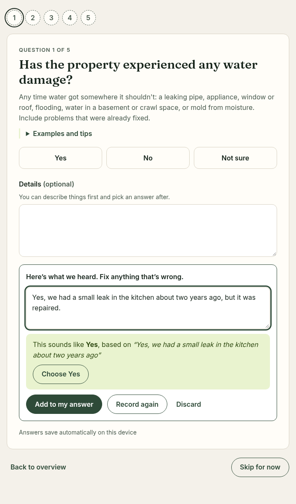
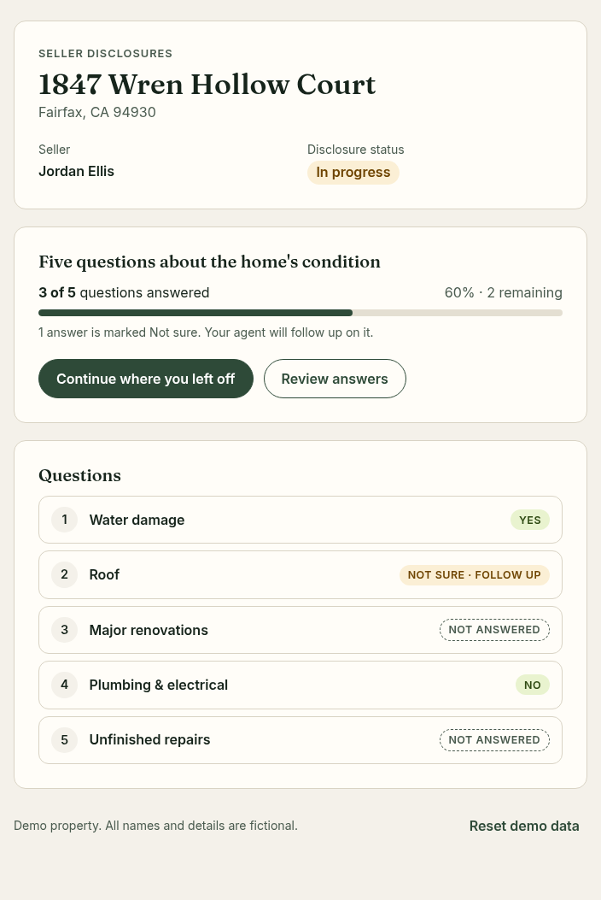
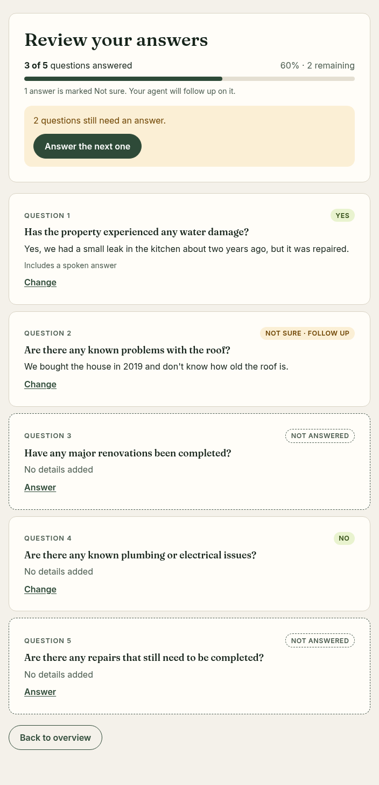

# Seller Disclosure Assistant

A small Next.js app where a homeowner answers five property-disclosure questions by typing or by voice. Speech goes through a server route that calls the provided OpenAI API, and the homeowner reviews every transcript, and confirms any suggested answer, before anything is saved.



## Running it

Requires Node.js 22.12+ or 24 (see `.nvmrc`).

```bash
npm install
cp .env.example .env.local   # then set OPENAI_API_KEY
npm run dev                  # http://localhost:3000
```

Without a key the app still works: voice answers are hidden with a short note, and typing works as usual.

Tests:

```bash
npm test                          # unit tests (Vitest)
npx playwright install chromium   # once, for the browser tests
npm run e2e                       # browser tests with a fake microphone and a mocked API
REAL_API=1 npm run e2e -- e2e/real-api.spec.ts   # one test against the real API (needs the key)
```

## Where each requirement is

| Requirement | Where |
| --- | --- |
| Property overview: address, seller, completion status | `/`, `src/components/Overview.tsx` |
| Five questions with Yes / No / Not sure, optional explanation, editable answers | `/q/[id]`, `src/components/QuestionView.tsx`; content in `src/lib/questions.ts` |
| Voice: mic button, record, transcribe with the provided API, show, review and edit before saving, typing still available | `src/components/VoiceAnswer.tsx`, `src/hooks/useRecorder.ts`, `src/app/api/transcribe/route.ts`, `src/lib/openai.ts` |
| Suggested Yes / No / Not sure that the homeowner must confirm | `src/lib/suggest.ts`, shown in `VoiceAnswer.tsx` |
| Progress: "3 of 5", "60%", "2 remaining", unanswered questions marked | `src/components/ProgressSummary.tsx`, `getProgress` in `src/lib/answers.ts` |
| Review and edit screen | `/review`, `src/components/ReviewView.tsx` |
| Answers survive a refresh | `src/lib/storage.ts`, `src/lib/answers-store.ts` |
| Extra feature: plain-language help for every question | `hint` in `src/lib/questions.ts` |

| Overview | Review |
| --- | --- |
|  |  |

## How it works

### Voice

1. "Answer by voice" asks for the microphone and records with `MediaRecorder`: WebM/Opus in Chrome, Firefox and Safari 18.4+, MP4/AAC on older Safari. One recording is capped at 2 minutes.
2. When the homeowner stops, the clip is posted to `/api/transcribe` with the question id.
3. The route checks the size and type, names the file after its real container (the API detects the format from the file name), and calls `POST /v1/audio/transcriptions` with `gpt-transcribe`. The question is sent as the prompt and a few domain words ("sump pump", "GFCI") as keywords, which helps with spelling.
4. The transcript appears in an editable box. If the words clearly say Yes, No or Not sure, the app shows a suggestion with the quoted phrase it is based on. Nothing is selected until the homeowner taps it. "Add to my answer" appends the text to their explanation.

The key is read only in `src/lib/openai.ts`, which imports `server-only`, so a client import fails the build. The browser only ever talks to this app. If transcription fails, the recording is kept and "Try again" resends it. Each failure (microphone blocked, no microphone, unreadable audio, service busy or down, no key configured) has its own message, and typing always remains an option.

### State

Answers are a map from question id to `{ choice, note, usedVoice, updatedAt }`. A pure reducer in `answers.ts` applies changes. `answers-store.ts` treats localStorage as the source of truth and hands it to React through `useSyncExternalStore`, which avoids server/client hydration mismatches and keeps two open tabs in sync. Saved data carries a version number and is validated on load, so old or corrupt data resets instead of crashing the page.

Answers save as the homeowner goes; there is no Save button. A question counts as answered once Yes, No or Not sure is picked. Notes on their own don't count, and the overview says so.

## Decisions and trade-offs

- **Next.js, with a route handler as the "lightweight server".** One app and one `npm run dev`, and the key never leaves the server.
- **Record, then transcribe.** The brief asks for record-and-transcribe. I also tried OpenAI's Realtime transcription over WebRTC, where words appear while you speak. It works, but the browser has to connect to OpenAI directly instead of going through this app, and in my test the words spoken before the connection was ready were lost. Here those are often the "Yes" or "No" the suggestion relies on. GPT-Live is a conversational agent that talks back, which the brief says isn't needed.
- **Suggestions from rules, not a model.** The rules are deterministic, covered by 49 test cases (`src/lib/suggest.test.ts`), and say nothing when unsure. Belief hedges such as "I think so" or "I don't think so" become Not sure, never No. "Not that I know of" becomes No, shown as "as far as you know". "No, but…" gets no suggestion. A language model would catch more indirect answers, but it would need a check against invented evidence and would add a second call.
- **"Not sure" is a real answer.** It counts toward progress but is flagged for the agent, because a blank reads as an omission while an honest "I don't know" is a disclosure.
- **The seller's words are kept.** Transcripts are added verbatim after the seller's edits; the app never rewrites an explanation.
- **Plain-language help (the extra feature).** Each question says what counts in one sentence (including problems that were already fixed), gives examples, and says what to do when unsure. Most of what makes disclosure forms intimidating is not knowing what counts.
- **Design.** Colors follow loqol.ai. One question per page with a step indicator, large tap targets, phone-width layout, and labelled, announced microphone states for keyboard and screen reader users.

## Limitations

- Answers live in one browser on one device. Clearing site data erases them.
- Automated tests run in Chromium with a fake microphone. Firefox and Safari use the same code path but haven't been tested by hand.
- The suggestion rules are English-only and tuned to these five questions.
- `/api/transcribe` only rejects cross-site browser requests. A public deployment would need sign-in and rate limiting.
- The app doesn't store audio, but recordings are sent to OpenAI to be transcribed.

## With more time

- Live captions relayed through the server: the browser streams to this app and the app talks to OpenAI, buffering audio until the connection is ready so the first words aren't lost.
- A conversational intake for longer sections: a GPT-Live session that asks follow-up questions and writes structured answers, each still confirmed by the seller.
- An agent view: answers that need follow-up, comments, and a signed, versioned snapshot, where a later change becomes a new disclosure instead of an edit.
- A backend so the seller and agent see the same answers.
- Spanish and Chinese.
- Measuring how many answers are given by voice, how often suggestions are accepted or changed, and the Not sure rate per question.

## Notes

- Built with AI assistance (Claude Code), which the brief allows.
- The property and seller are fictional.
